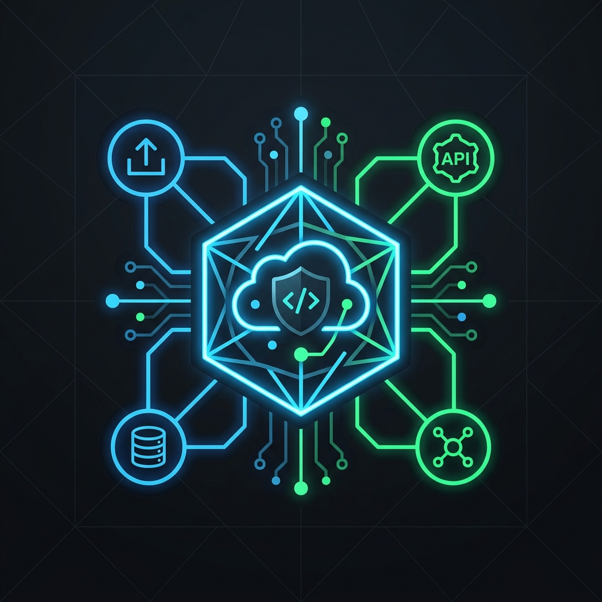

# Hi there, I'm Mathias Koeppel 👋

  

Senior Cloud Architect, Security Engineer, and AI Automation Consultant. I specialize in designing, securing, and operating highly resilient systems across Azure Government, AWS GovCloud, Kubernetes, and Identity governance spaces.

---

## 🛠️ Expertise & Focus

*   **Cloud Infrastructure**: Azure, Azure Government, AWS GovCloud, Private Kubernetes (AKS/EKS), Bicep, Terraform, GitHub Actions.
*   **Security & Identity**: Incident Response, Entra ID, Okta, SSO Federation, Conditional Access, DLP, Zero Trust architectures.
*   **Automation & Practical AI**: Custom cloud workflow automations, LLM operations, secure prompt governance.

---

## 🚀 Active Open Source Projects

*   **[Privacy Tracker](https://github.com/pinksnafu/trackmeprivately)** 📊: A zero-cookie, privacy-respecting analytics platform built with Next.js, SQLite, and biometric Passkeys (WebAuthn) for fast, lightweight self-hosting on single VPS structures.

---

## 📬 Contact & Engagements

*   **Consulting Inquiries**: Send a short brief to [mdkoeppel@icarus.onl](mailto:mdkoeppel@icarus.onl)
*   **Consultation Booking**: Schedule a direct sync at [Google Appointment Schedule](https://calendar.app.google/Hk2P8kEQQUgJHsmK7)
*   **LinkedIn**: Connect with me on [LinkedIn](https://www.linkedin.com/in/mathias-koeppel-4327b578)
